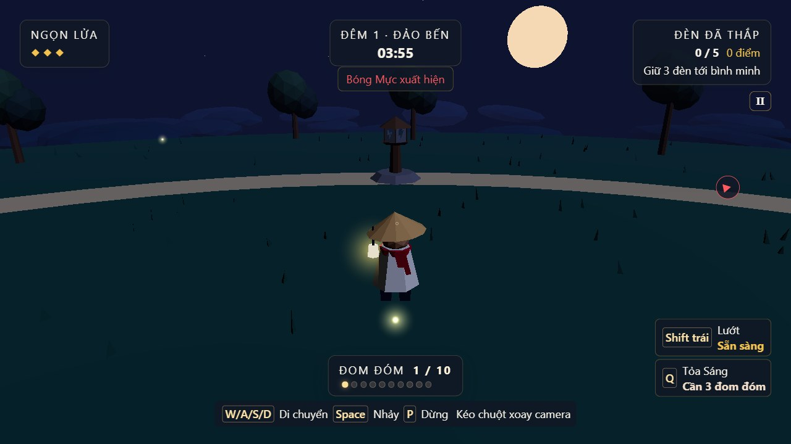

# Đảo Đèn Lồng

[Video demo](https://github.com/pnt2504/K5-L3A-DAY12-PhanNhatTruong-2A202603459-AI-SDLC-Dao-Den-Long/releases/download/v1.0.0/dao-den-long-demo.mp4) · [Tải bản web v1.0.0](https://github.com/pnt2504/K5-L3A-DAY12-PhanNhatTruong-2A202603459-AI-SDLC-Dao-Den-Long/releases/tag/v1.0.0)

Bạn điều khiển Mây gom đom đóm, châm dầu và giữ đủ đèn sáng tới bình minh trên ba hòn đảo. Bản phát hành v1.0.0 dùng Test Contract v1.3.



## Cài và chơi

Cần Node.js 22.12 trở lên, npm và trình duyệt có WebGL 2. Trên macOS, Linux hoặc Windows, chạy từ thư mục repo.

```sh
npm ci
npm run build
node scripts/run.js
```

Mở địa chỉ hiện trong terminal nếu trình duyệt chưa bật. Với file phát hành đã build, giải nén rồi chạy lệnh cuối trong thư mục vừa giải nén. Chọn **Bắt đầu** rồi **Vào đêm**. Thêm `?seed=12` vào URL để tái tạo bố cục đầu Đêm 1. **Chơi lại Đêm** dùng cùng seed.

| Phím | Hành động |
|---|---|
| **WASD** | Di chuyển theo camera |
| **Kéo chuột** hoặc **← / →** | Xoay camera |
| **Space** | Nhảy |
| **Shift** | Lướt trong 0,2 giây. Hồi chiêu 1,5 giây, hoặc lướt liên tiếp khi có Bùa Gió |
| **E** | Tương tác trong tầm 2 m. Đèn mới cần 10 đom đóm, đèn đã tắt cần 5 để thắp lại. Đèn đang sáng nhận thêm dầu |
| **Q** | Tỏa Sáng. Tốn 3 đom đóm, đẩy và làm choáng Bóng Mực trong tầm 5 m. Hồi chiêu 3 giây |
| **Esc** hoặc **P** | Tạm dừng hoặc tiếp tục |

Mục **Cài đặt → Đổi phím** cho phép đổi từng hành động và khôi phục mặc định. Game cũng lưu âm lượng, độ nhạy chuột, bảng màu, giảm chuyển động và chữ lớn. Chữ UI ở 1280×720 có cỡ tối thiểu 18 px và tùy chọn 22,5 px. Các chỉ báo hiện hướng Bóng Mực mới xuất hiện, gió sắp thổi, các đèn ít dầu và 10 giây cuối.

Đảo Bến, Đảo Cau và Đảo Chuông yêu cầu giữ ít nhất **3/5**, **4/6** và **5/7** đèn đến hết **4:00**, **4:30** và **5:00**. Mỗi đêm bắt đầu với 3 Ngọn Lửa. Đèn khởi đầu với 100 dầu khi được thắp và hao 1 dầu mỗi giây. Mỗi đom đóm châm thêm 10 dầu. Dưới 30 dầu, đèn nhấp nháy, mất vùng an toàn và có thể bị Bóng Mực hút dầu. Mỗi lần thắp tăng sức chứa thêm hai, từ 10 lên tối đa 20. Gió Lạc vẫn có thể cướp đom đóm ở hai đêm sau.

Mỗi đom đóm nạp hoặc châm được **5 điểm**. Lần thắp đầu được **100**, thắp lại được **40**. Tỏa Sáng được **5 điểm** mỗi Bóng Mực trúng, hoặc **15** nếu nó đang hút dầu. Khi thắng ở bình minh, mỗi đèn sáng thưởng **50 cộng số dầu nguyên còn lại**, và mỗi Ngọn Lửa còn lại thưởng **50**. Màn Bình Minh hiển thị tổng điểm các đêm đã thắng.

## Bảng xếp hạng

Sau khi thua hoặc tới Bình Minh, có thể lưu tổng điểm các đêm đã thắng. Tên dài 3–12 ký tự chữ cái Latin, chữ số hoặc dấu gạch dưới. Bảng giữ 10 mục điểm cao nhất, bằng điểm thì thành tích sớm hơn đứng trước. Bản chạy cục bộ lưu ở `~/.dao-den-long/leaderboard.json` và xuất bằng lệnh dưới đây.

```sh
node scripts/run.js --export-leaderboard leaderboard.json
```

Khi đưa riêng thư mục `dist` lên hosting tĩnh, bảng xếp hạng lưu trong hồ sơ trình duyệt. Lệnh xuất từ terminal đọc bảng điểm của trình chạy cục bộ.

## Kiểm chứng và đo hiệu năng

```sh
npm test
node src/headless.js --seed 12 --night 1 --ticks 180 --snapshot-every 30 --scenario test/fixtures/phase-3/maintenance.scenario.json --inputs test/fixtures/phase-3/maintenance.inputs.json --out out.jsonl
node scripts/bench.js --seed 42 --duration 30 --out bench.json
node --jitless --expose-gc scripts/soak.js --seed 7 --nights 10 --out soak.json
```

CLI headless nhận `--night 1`, `2` hoặc `3`. Ví dụ kiểm tra đèn cạn, thắp lại, châm dầu, Bóng Mực hút và kết quả ở bình minh. Benchmark dùng bản build, chạy Chromium trong cửa sổ với viewport 1280×720, cần môi trường đồ họa và WebGL 2. Script dùng Chrome hoặc Chromium có sẵn, hoặc tải Chromium qua Playwright nếu thiếu. Ba giây đầu là khởi động. Chromium được mở với `--disable-gpu-vsync` và `--disable-frame-rate-limit`. Giá trị `peak_mem_mb` là `null` vì renderer web không có RSS tiến trình để ghi. [Cờ Chromium](https://chromium.googlesource.com/chromium/src/+/HEAD/components/viz/common/switches.cc) · [Cài browser Playwright](https://playwright.dev/docs/browsers)

Soak giữ một tiến trình và dùng seed từ 7 trở đi, xoay Đêm 1–3. RSS được đọc sau khi tải đêm đầu và sau khi giải phóng đêm cuối, với GC ở cả hai mốc. Trình chạy soak dùng `--jitless` để V8 tránh cấp phát mã máy khi mô phỏng headless chạy lâu. Chạy `node scripts/check-browser.js` để kiểm tra trình duyệt và lưu bằng chứng cục bộ. [Chế độ JIT-less của V8](https://v8.dev/blog/jitless)

- [Bằng chứng Phase 4](docs/proof/phase-4/README.md) · [Benchmark](bench.json) · [Soak](soak.json)
- [Retro bốn phase](docs/retro.md) · [Changelog](CHANGELOG.md) · [Giấy phép](LICENSE)
- [Bằng chứng Phase 1](docs/proof/phase-1/README.md) · [Bằng chứng Phase 2](docs/proof/phase-2/README.md) · [Bằng chứng Phase 3](docs/proof/phase-3/README.md). Chạy script tương ứng tại tag của phase.
- [Hướng dẫn cho agent](AGENTS.md) · [Nguồn và công cụ](CREDITS.md)

## Sáng tạo của tôi

Đường đá thành vòng nối các đèn với khoảng sân ở giữa, để người chơi có mốc định hướng khi xoay camera. Chi tiết này chỉ được dựng trong cảnh 3D. Bài kiểm chứng headless dùng cùng logic game và kiểm tra đầu ra theo seed.

---

## Đề bài Day 12 — AI SDLC

> **Cá nhân** (1 người / 1 MSSV) · Áp dụng SDLC cùng AI để xây một **game 3D** qua **4 phase**, từ yêu cầu ban đầu tới bản phát hành.
> **Lab board + trợ giảng:** **[Đảo Đèn Lồng Lab](https://claude.ai/artifact/Q1RYyv1dxjUczzCbd2ZnoW)**

---

## Tài liệu của lab

| File | Nội dung |
|---|---|
| [GUIDE.md](GUIDE.md) | Hướng dẫn làm lab: vòng làm việc mỗi phase, harness, kiểm chứng, token |
| [CHECKPOINTS.md](CHECKPOINTS.md) | Các mốc tự kiểm tra từ chuẩn bị đến nộp bài |
| [SUBMISSION.md](SUBMISSION.md) | Đặt tên repo, hạn nộp, tag, Release, video, checklist |
| [RULES.md](RULES.md) | Quy định: AI, trung thực về bằng chứng, bản quyền, bảo mật |
| [RUBRIC.md](RUBRIC.md) | Thang điểm chi tiết |

## Lab board

Yêu cầu dự án được phát hành tại **[Đảo Đèn Lồng Lab](https://claude.ai/artifact/Q1RYyv1dxjUczzCbd2ZnoW)**. Mỗi phase là một tab (tab chưa phát hành bị khóa), mỗi tab có trợ giảng AI riêng chỉ trả lời trong phạm vi phase đó. Trợ giảng cần đăng nhập claude.ai và dùng lượt Claude của bạn.

## Dự án

**Đảo Đèn Lồng**: game 3D góc nhìn thứ ba. Mây, người giữ đèn nhỏ tuổi, gom đom đóm để thắp lại các Đèn Lồng Lớn và né Bóng Mực trong sương đen.

- Không ràng buộc công nghệ; chạy được trên macOS hoặc Linux.
- Tuân theo **Test Contract** (chế độ headless) để được chấm tự động và so sánh với nhau.

| Phase | Bạn nhận | Nộp |
|---|---|---|
| 1 | **PRD-0** (mô tả tổng quát) + Test Contract | tag `phase-1` |
| 2 | **Ticket-02**, phát hành khi Phase 1 kết thúc | tag `phase-2` |
| 3 | **Ticket-03**, phát hành khi Phase 2 kết thúc | tag `phase-3` |
| 4 | **Ticket-04**, phát hành khi Phase 3 kết thúc | tag `phase-4` + Release `v1.0.0` |

Yêu cầu sẽ được bổ sung và có thể thay đổi giữa các phase, giống dự án thật.

### Lịch 4 giờ

Bài lab kéo dài **4 giờ**. Phase 1 và 2 khoảng **1 giờ**, Phase 3 khoảng **30 phút**, Phase 4 khoảng **1 giờ 30 phút**. Mỗi phase phát hành đúng mốc giờ. Phase mới xuất hiện trên lab board khi tới mốc.

| Mốc | Sự kiện | Hạn tag |
|---|---|---|
| 0h | Phát hành **Phase 1** (PRD-0), gồm cả phần chuẩn bị | `phase-1` trước mốc 1h |
| 1h | Phát hành **Phase 2** | `phase-2` trước mốc 2h |
| 2h | Phát hành **Phase 3** | `phase-3` trước mốc 2h30 |
| 2h30 | Phát hành **Phase 4** | `phase-4`, Release `v1.0.0` và video trước mốc 4h |
| 4h | Hết giờ lab, chốt bài | |

Hết giờ mỗi phase thì tag và chuyển sang phase tiếp theo, dù phase chưa hoàn hảo. Chỗ chưa xong ghi trung thực trong bằng chứng.

---

## Gợi ý SDLC (cách làm là của bạn)

Mỗi phase là một vòng nhỏ. Công cụ, thứ tự, định dạng tài liệu đều tự do; đây chỉ là gợi ý:

1. **Requirements:** biến yêu cầu thành tiêu chí nghiệm thu kiểm chứng được. Chỗ mơ hồ thì tự giả định và ghi lại.
2. **Plan:** nghĩ cách kiểm chứng **trước** khi để agent viết code.
3. **Build:** để agent viết, bạn điều phối và review.
4. **Verify:** chạy thật, kiểm tra hành vi thật. *Không có bằng chứng thì chưa xong*: "agent bảo chạy rồi" không phải bằng chứng.
5. **Evaluate:** cái gì đạt, AI sai ở đâu, harness (AGENTS.md, skill, hook) cần chỉnh gì.
6. **Release:** gắn tag.

## Ba điều cần nhớ

> Bạn được **tự do sáng tạo thêm** quanh phần lõi (nhân vật mới, kẻ địch mới, cơ chế nhỏ, câu chuyện, hiệu ứng, âm thanh…). Sáng tạo gọn và không phá yêu cầu được tính điểm trong hạng mục F của [RUBRIC](RUBRIC.md); ghi mục "Sáng tạo của tôi" trong README của bạn.

- **Game tốt là game đúng yêu cầu của khách hàng**, không phải game phức tạp hay đẹp nhất. Làm đúng và chứng minh được là đúng trước, trau chuốt sau.
- **Cân nhắc kỹ quota token của bạn.** Đốt nhiều token không làm bài tốt hơn. Ngữ cảnh gọn, kế hoạch rõ, kiểm chứng sớm thường vừa rẻ vừa đúng hơn chạy agent liên tục.
- **Kiểm chứng là phần quan trọng nhất.** Bằng chứng (test, output headless, ảnh, số đo) đáng giá hơn lời mô tả.

---

## Bàn giao cuối cùng

Một **repo GitHub cá nhân, public**, gồm:

1. **Toàn bộ mã nguồn** của game qua 4 phase, tag `phase-1` … `phase-4`, Release `v1.0.0`.
2. **Video demo `.mp4` dưới 5 phút** (đính kèm Release `v1.0.0` hoặc `docs/demo/demo.mp4`, link ở đầu README): chơi thử và cho thấy bằng chứng game chạy đúng.
3. **Bằng chứng kiểm chứng** của từng phase (định dạng tự chọn).
4. **Harness AI đã dùng** (AGENTS.md / CLAUDE.md, skills, hooks, plugins…), giữ nguyên trong repo và lịch sử git.
5. **Ghi chép ngắn:** spec/giả định mỗi phase, nhật ký dùng AI (gồm token/chi phí ước tính), retro.

Không commit API key, token hay `.env`. Gửi link repo theo hướng dẫn của Coach.

## Đánh giá (100 điểm)

| Hạng mục | Điểm |
|---|---|
| Test tự động ẩn (headless, gồm kiểm tra lại phase trước) | 30 |
| Kiểm chứng & bằng chứng của bạn | 20 |
| Quy trình SDLC & harness AI | 15 |
| Evaluation & retro (gồm cách bạn dùng token) | 10 |
| Hiệu năng & ổn định | 10 |
| Chất lượng sản phẩm (đúng yêu cầu, chơi được) | 10 |
| Video demo | 5 |

## Quy định

- Dùng AI thoải mái; không sao chép repo của người khác.
- Bằng chứng phải thật: test luôn đạt hay output sửa tay là vi phạm.
- Nhân vật, bối cảnh là bản gốc của lab; asset bên ngoài chỉ dùng loại CC0/CC-BY/MIT hoặc tự tạo, ghi nguồn trong `CREDITS.md`.
